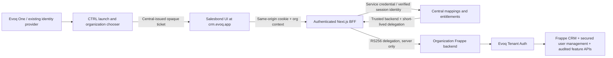

# Salesbond CRM frontend integration plan

**R77 update — development approved:** The user approved development, security remediation, testing and integration-branch commits/pushes. Production remains HOLD. Implementation is in isolated development clones; full feature parity and production acceptance are not complete. See [R77 implementation progress](R77_SALEBOND_CRM_IMPLEMENTATION_PROGRESS.md) for changed files, tests, disabled capabilities, branch provenance and outstanding blockers. Earlier planning-only statements below describe the original review scope.

**Review date:** 5 November 2026 (Asia/Kolkata).  
**Disposition:** planning complete; implementation and deployment have not begun.  
**Primary target:** `/home/arundas/Projects/SDL/ERP/salesbond-crm/salesbond-crm-sdldev1`.  
**Scope:** source review, existing local test execution, read-only production inspection, migration design. No application edits, merges, deployments, database changes, or infrastructure changes were made for this review.

## 1. Executive summary

Adopt Salesbond as the sole primary CRM frontend development codebase. Preserve its current UI, metadata-driven forms, conversion workflows, settings, dashboard and reports integrations. Integrate EVOQ authentication, BFF, tenant resolution and user-management behavior into that application through a single server-side security boundary.

**Salesbond does not currently contain the required EVOQ BFF/security architecture. It is not ready to replace `crm.evoq.app`.** Its Next.js route handlers are API intermediaries, but they accept browser-supplied credentials and use a globally configured backend. Their presence does not establish an authenticated EVOQ BFF. Authentication tokens are deliberately stored in JavaScript-readable cookies and localStorage and passed into federated reports components.

The directory identified as legacy in the request is also **not the current production integration baseline**. Three distinct sources must be distinguished:

1. Salesbond: latest product implementation, mandatory target for all new CRM work.
2. Original `NEXTJSFRONTEND/crm-frontend`: stale `d034737` checkout with untracked BFF additions; reference only.
3. `NEXTJSFRONTEND/crm-frontend-embed`: current EVOQ integration reference at `ad2dac9`, including R55–R80 fixes. All 1,003 production files under `src`, `tests`, and `public` hash-match this reference. Its security/session/tenant integration and CTRL embedding must be preserved through adaptation.

The existing EVOQ baseline also needs hardening. Do not copy it wholesale: a known development session-signing fallback remains; ticket redemption falls back to non-atomic read/delete; tenant JWT verification omits issuer enforcement and explicit application matching; SSRF controls are incomplete; mutation CSRF enforcement and application rate limits are missing in the reviewed BFF. These are release blockers, even though the existing reference suite passed **150/150** tests.

The largest feature-compatibility blocker is backend scope. Salesbond depends on `sdl_metadata`, `report_addon`, Insights and the retired `sdl_user_management.sdk.api` contract. The recorded EVOQ tenant stack instead uses Frappe CRM, Evoq Tenant Auth and secured `sdl_user_management` 2.0.2. A locally reviewed Salesbond metadata dashboard-save endpoint is guest-accessible and saves with `ignore_permissions=True`. Installing that dependency unchanged is unacceptable. Preserving the new UI requires secure backend contracts and, where necessary, separately approved additive backend releases.

**Recommendation:** implement in a branch from the exact Salesbond head, port selected EVOQ service behavior and tests, harden shared security dependencies, build explicit API adapters, validate in isolated staging, then conduct an approved gradual cutover. Retain both old frontend trees and the current production artifact until rollback is proven.

## 2. Evidence, provenance and limits

### 2.1 Source inventory

Paths below use these aliases only within this document:

| Alias | Absolute location / provenance | Observed state |
|---|---|---|
| `S` | `/home/arundas/Projects/SDL/ERP/salesbond-crm/salesbond-crm-sdldev1` | Git `3b756d726a374c656c16eec08c917e5f6211fcea`, branch `crm-frontend-withlayout-arun`; origin `http://git.socialdnalabs.com/sdl-products/salesbond-crm-sdldev1.git`; untracked files exist |
| `L` | `/home/arundas/Projects/SDL/ERP/EVOQCLOUD/NEXTJSFRONTEND/crm-frontend` | `main`, `d034737d44103c9fd2778e75dbb232c2a58c530b`; origin `arundassdl/crm-frontend`, second remote `evoq-tech/crm-frontend`; untracked auth/proxy/session/org/test additions |
| `R` | `/home/arundas/Projects/SDL/ERP/EVOQCLOUD/NEXTJSFRONTEND/crm-frontend-r55` | R55–R64 integration mirror; no Git metadata in this directory; superseded for current-production behavior by `E` |
| `E` | `/home/arundas/Projects/SDL/ERP/EVOQCLOUD/NEXTJSFRONTEND/crm-frontend-embed` | `release/r80c-crm`, `ad2dac917d1bc3f6ae7d4e3e623ecd0c802c7284`; clean working tree on inspection |
| `C` | This workspace, `apps/evoq_saas_package_layer/evoq_saas_package_layer` | Central resolver, launch tickets, delegation tokens and revocation code reviewed; selected production file hashes compared |
| `T` | This workspace, `apps/evoq_tenant_auth/evoq_tenant_auth` | Tenant JWT verifier and user-sync boundary reviewed |
| `U` | `/home/arundas/Projects/SDL/ERP/EVOQCLOUD/evoqcloudcentral/sdl_user_management-secure/sdl_user_management` | Secured `um.py`, `policy.py`, hooks and security test source; production `um.py` hash matches |
| `B` | `/home/arundas/Projects/SDL/ERP/salesbond-crm/crm-backend/apps` | Local Salesbond backend dependencies: `sdl_metadata`, `report_addon`, Insights, CRM and legacy user management; focused API/security inspection only |

Do not confuse `S` with the additional similarly named directory under `NEXTJSFRONTEND`. The user-designated absolute Salesbond path is authoritative.

### 2.2 Evidence register

| ID | Actual source inspected | What it establishes |
|---|---|---|
| E01 | `S/src/middleware.ts`, `src/lib/route-role-utils.ts` | Feature-flagged `isLoggedIn`/menu/role-cookie routing; API paths excluded; role checks can allow when menu data is absent; exception path continues |
| E02 | `S/src/utils/accessTokenDataStorage.ts`, `resolve-request-authorization.ts`, `frappe-authorization.ts`, `src/store/slices/auth/token-login-slice.ts` | Browser-readable credential persistence; header/body/cookie auth mechanisms; client-influenced identity and role hints |
| E03 | `S/src/services/api/auth/{login_api,token-login-api,logout_api}.ts` | Tenant credential login/logout, not EVOQ launch/global logout |
| E04 | `S/src/services/config/{app-config,app-config-example,api-config}.ts` | Global backend; actual ignored config uses `let ENV = 'DEV'` and `https://crmapp.socialdnalabs.com`; example uses `crmappv1.local:8000`; retired SDK contract |
| E05 | `S/src/app/api/{datalist,docs/update,dashboard/list,insights-query-result}/route.ts` | SQL-fragment forwarding, caller auth forwarding, metadata/Insights backend dependencies, incomplete validation/error filtering |
| E06 | `S/src/app`, `src/components/{Leads,Deals,Contact,Customer,Tasks,layout-builder,reports,analytics}`, `src/services/api/{crm,sdl-metadata,report-addon,permissions,territory}` | New UI/module surface and API dependencies; source presence is not runtime acceptance |
| E07 | `S/next.config.js`, `src/config/microfrontends/*`, `src/lib/mf/*`, `src/lib/reportsEmbed/reportsEmbedConfig.ts` | Runtime federation, development-host defaults, token props, `/reports/api/*` rewrite bypass, image-host configuration |
| E08 | `L/src/lib/{session,tenant-resolver}.ts`, `src/app/api/proxy/[...path]/route.ts`, middleware and tests | Early BFF pieces coexist with old middleware/routes; no complete protected application boundary |
| E09 | `E/src/lib/{session,central,tenant-resolver,tenant-fetch,frappe-list,frappe-doc,user-management}.ts` | Current EVOQ signed session, Central routing, adapters, validation and secured user-management integration |
| E10 | `E/src/app/api/auth/*`, `src/lib/{global-logout,logout-response,logout-page,one,ctrl,embed}.ts`, org layouts and `CrmShell` | Launch redemption, safe return paths, global logout/retry, page-organization binding, embedding and navigation behavior |
| E11 | `C/api/{internal_tenant_resolver,internal_launch_tickets}.py`, `C/iam/{launch_tickets,delegation_tokens,session_revocation}.py` | Service auth, membership/entitlement mapping, ticket lifetime/consumption and JWT minting; limitations described below |
| E12 | `T/auth.py`, `T/user_sync.py`, `U/{um,policy}.py` | Tenant verification, enabled-user mapping, fixed role profiles, owner/self-change protections, role/status audit comments |
| E13 | `B/sdl_metadata/sdl_metadata/api/{dashboard,layout,custom_field,lead_conversion}.py`; `B/report_addon/report_addon/api/insights_query.py` | Additional backend contract requirements and insecure dashboard-save implementation; query API has a read-permission check despite guest decoration |
| E14 | SSH read-only service/config/build/hash inspection on production | Current service, build, Nginx headers, environment key names and file parity; no secret values recorded |
| E15 | `E/tests/*.test.ts` executed with installed `tsx` | 150 tests, 37 suites, all pass; mocks/static assertions do not prove live security completeness |

Prior records are supporting context, not substitutes for source: [R55](59-r55-crm-delegation-auth-and-module-data-fetching-fix.md), [R59](63-r59-crm-global-logout-and-sso-session-security.md), [R63](67-r63-sdl-user-management-tenant-auth-integration.md), [R64](68-r64-github-synchronization-and-production-deployment.md), [R66](70-r66-local-github-production-synchronization-audit.md), and [R80 §12.13](80-ctrl-embedded-crm-unified-workspace-plan.md). Earlier rollout holds/statuses in those records may have been superseded; this review does not transfer their implementation authorization to this task.

### 2.3 Verification limits

- No authenticated customer UI session, production CRUD, login/logout, or tenant database access was used. Feature availability below means source exists, not demonstrated correctness against EVOQ tenants.
- No remote Git fetch or `ls-remote` was performed. Remote branch equality is recorded in R80; local commit and production file equality were independently checked.
- Production frontend has no usable `.git` metadata. Commit attribution uses the matching local source and R80 release record, not a nonexistent production branch command.
- Backend source review is focused on trust boundaries and representative contracts; a complete endpoint/schema inventory and backend security audit remain implementation prerequisites.
- Existing test execution initially hit sandbox IPC restrictions; the approved rerun completed successfully. Temporary evidence: `/tmp/salesbond-review-production-sha256.txt` and `/tmp/salesbond-review-evoq-reference-tests.log`. Durable conclusions are captured here; those temporary files are not release artifacts.

## 3. Current architecture assessment

### 3.1 Salesbond

Next.js App Router / React 18 / TypeScript / MUI, Redux and other client state libraries, dynamic form/layout components, runtime Module Federation for analytics/reports. The root client layout hosts providers; feature routes each provide layouts. There are 43 `route.ts` API handlers. The package declares Next `^14.2.5`; the local lock resolves **14.2.35**. Jest/Testing Library dependencies and `test: jest` exist, but no maintained automated test files/configuration were found in the reviewed application tree; `scratch_test.js` is an ad hoc filter experiment.

Current data paths are mixed:

```text
Browser -> globally configured Frappe URL + JavaScript-visible Authorization
Browser -> Next /api/datalist, /api/docs/*, /api/dashboard/* -> globally configured Frappe URL
Browser -> federated analytics/reports code (token props / backend config)
Browser -> /reports/api/* -> external reports application rewrite
```

No Salesbond `src/lib/session.ts`, trusted tenant resolver, EVOQ launch handler, org route tree, or `/api/proxy` EVOQ implementation was found. Changing only `API_BASE_URL` would leave server handlers, reports rewrites, roles and token consumers incompatible or insecure.

### 3.2 EVOQ reference and production

```text
Evoq One identity / CTRL organization launch
  -> Central opaque one-use launch ticket
  -> CRM /api/auth/launch redeems ticket with Central
  -> host-only signed CRM session cookie
  -> CRM BFF -> Central resolver (membership, entitlement, instance, revocation)
  -> tenant-bound short-lived RS256 delegation JWT
  -> organization Frappe site -> Evoq Tenant Auth -> local enabled User
  -> Frappe CRM permissions / secured sdl_user_management.um.*
```

The launch ticket is **opaque**, not an RS256 JWT. RS256 belongs to the subsequent server-to-server delegation token. Preserve these separate responsibilities; do not require the browser or launch route to parse a delegation JWT as a login credential.

Current integration includes adapters for standard Frappe data APIs, centralized entry/global logout, self profile, manager-controlled users/roles, and CTRL embedding. It remains only partially hardened as documented in §6. Module pages still have root paths such as `/leads`; `/org/TEAM-00076/` is the org landing route. A single host cookie represents one active organization across all tabs. R80 adds stale-page protection, but its organization header is optional.

## 4. Feature-by-feature comparison and gaps

Legend for feature columns: **Present** = actual source; **Limited** = some related source/behavior; **Absent** = no equivalent found. No row claims live Salesbond compatibility.

| Feature | Salesbond `S` | Original legacy `L` | Current EVOQ `E` | Integration decision / gap |
|---|---|---|---|---|
| Leads list/detail/create/edit | Present; dynamic fields/layouts | Present; older forms | Present; standard Frappe adapters | Keep Salesbond UI; map fields, validation and error contracts |
| Lead conversion and duplicate resolution | Present: `/leads/convert/[slug]`, `services/api/crm/*` | No equivalent conversion route found | No equivalent new mapping UI found | Preserve; secure `sdl_metadata` conversion/mapping API or implement compatible adapter |
| Deals, pipeline/kanban, tasks | Present | Present, older components | Present, delegated CRUD | Preserve new interactions; validate `deal_value`, status/stages, child rows and related-task permissions |
| Contacts, accounts, related records | Present | Present | Present; structured related filters and corrected response adapters | Preserve Salesbond displays; port permission-aware relation semantics; never restore raw joins |
| Tasks/activities/notes/comments/files | Present | Present | Present; delegated routes | Map CRM Task and links; secure files/downloads and activity mutations |
| Users/roles/profile | Present, broad legacy SDK CRUD/password paths | Older SDK screens | Secured `um.*`, own-account and owner/self protections | Adapt new screens to Central identity and narrow user-management actions; no tenant account/password lifecycle |
| Permission matrix | Present, editable SDK matrix | Present, legacy contract | Fixed approved role profiles and Frappe permissions | Requires policy decision: richer secure model versus restricted UI actions; never honor client role hints |
| Settings and organization/company UI | Expanded settings sidebar/sections | Limited account/company pages | Own account and organization context | Preserve layouts; distinguish working API-backed panels from placeholders such as settings sections |
| Metadata forms/layout builder/custom fields | Present: customization/module/layout routes, quick create, field/layout permissions | No equivalent new setup tree found | No equivalent new setup tree found | Backend dependency and privilege audit required; no automatic System Manager grants |
| Territory tree/setup | Present | Limited setup APIs | Not equivalent to latest tree UI | Replace SDK APIs with a scoped permitted tree contract; verify required DocTypes exist |
| Dashboard | New selector/builder/widgets/federation | Older dashboard/widgets | Permission-scoped real metrics; currency/won-stage behavior | Preserve builder; retain proven metrics semantics; secure additional backend apps |
| Reports/analytics federation | Present with report create/detail/edit and dashboard remotes | Older local charts/report route | No equivalent federation host | Preserve feature; change remote API/auth interface to same-origin BFF without token props |
| Shell, navigation, theme/responsiveness | Latest shell/MUI/layout changes | Older shell | EVOQ shell plus R80 embedded theme/viewport/form fixes | Adapt R80 behavior into new shell; do not replace it with `CrmShell` wholesale |
| EVOQ SSO/BFF/org/subscription | Absent | Early untracked fragments | Present with hardening gaps | Selectively port and harden once |
| CTRL embedding, theme/message protocol | Absent equivalent EVOQ protocol | Absent | Present and deployed | Mandatory preservation: origin-checked messages, iframe sign-in/out, theme, navigation, viewport |
| Store/product/stock/warranty/checkout remnants | Source present | Source present | Some routes retained | Inventory reachable use; do not expose ERPNext modules on CRM-only tenant just because code exists |
| Localization, uploads, maps, notifications | Source/dependencies present | Source present | Some shared source | Feature-specific capability and permission tests; inspect external origins and service-worker caching |
| Automated EVOQ regression/security suite | No maintained suite found | Five early test files | Fifteen test files; 150 passing tests | Port behavior tests and add missing negative/integration cases |

The important legacy-only capabilities are the EVOQ platform integrations, secured administration, metrics/relationship corrections, global logout and embedding. The older UI itself is not a migration target.

## 5. Production deployment review

### 5.1 Independently observed live state

| Item | Read-only finding on 5 November 2026 |
|---|---|
| Public frontend | `https://crm.evoq.app/` |
| Host / service | `evoq-prod-01`, systemd `evoq-crm`, active |
| Working directory | `/var/evoq-frontends/crm` |
| Start command | `/usr/bin/node node_modules/next/dist/bin/next start -H 127.0.0.1 -p 3001` |
| Unit / environment file | `/etc/systemd/system/evoq-crm.service`, `/etc/evoq-crm/crm.env` |
| Current build ID | `cLKIfnURtEXIUpUICylHM`; service started 5 November, 11:43 IST (07:13 CET) |
| Frontend identity | EVOQ CRM R80, not the user-designated Salesbond checkout |
| Source parity | All 1,003 files under production `src`, `tests`, `public` match local `E`; sampled `next.config.js` also matches |
| Commit attribution | `E` is `ad2dac917d1bc3f6ae7d4e3e623ecd0c802c7284`; R80 records this as CRM `main` in both GitHub accounts; production has no `.git` |
| Repository lineage | `evoq-tech/crm-frontend` and `arundassdl/crm-frontend`, recorded production branch `main`; do not mistake local `L/main` at `d034737` for remote main |
| Next runtime | Installed production Next **14.2.30**; do not infer Salesbond runtime from this |
| Current Salesbond deployment | No evidence it serves `crm.evoq.app`; confirmed production differs from `S`. Whether this Salesbond head is deployed on another host remains unverified |
| Tenant auth / user management | Production Git heads `15196d4b8f8159a8e6b5aeee013635ba50b6eb61` and `f7b5e8368f115f7d684aa3ac8a56d7a672155aca`; verifier/`um.py` hashes match reviewed local files |
| Central package layer | Production head `1d761004ca62d5653563fc750a642d6dbed1d647`; launch-ticket implementation hash matches reviewed local source |

Salesbond's current origin is a different internal Git repository and branch, not either production GitHub repository. Decide its canonical release remote/branch and CI/deploy ownership before implementation handoff. Keep Salesbond's history and latest code; do not solve this by replacing its tree with production CRM.

### 5.2 Nginx and server-only preservation

Live `/etc/nginx/conf.d/evoq-crm.conf` terminates TLS, redirects HTTP to HTTPS, proxies to `127.0.0.1:3001`, and sets HSTS, `nosniff`, referrer policy, XFO `SAMEORIGIN`, and CSP `frame-ancestors 'self' https://ctrl.evoq.app`. Preserve CTRL framing support and verify the XFO/CSP combination in supported browsers. This CSP is a framing restriction, not a full script/connect policy.

Other live settings: body limit **20 MB**, upstream read timeout **120 seconds**, `keepalive_requests 1000`, proxy redirect normalization for localhost/loopback, forwarded host/protocol headers. No explicit rate-limit directive appears in this vhost; global/WAF limits were not inspected. Do not replace the vhost with a generic template. Node port/systemd supervision can stay compatible; a parallel candidate listener and approved upstream switch will be needed for safe cutover.

`src/services/config/app-config.ts` is intentionally Git-ignored and present on production. Although it hash-matches `E`, it is not safely reproduced by cloning Git. Preserve its behavior as reviewed configuration, then replace hardcoded development defaults with validated environment-driven configuration. Do not copy secret files into Git or frontend bundles. Production env/config/service/Nginx and build artifacts remain required release inputs even when tracked source matches.

The reference `next.config.js` defines `productionBrowserSourceMaps` twice; the effective last value is `true`. Salesbond currently sets it `false`. Keep production browser source maps disabled unless an explicit protected error-monitoring design is approved. Both source trees have broad image configuration for HTTP wildcard hosts on port 8012; replace with approved image handling. A reference Dockerfile uses Node 18, while the actual service uses host Node; do not adopt that container file as an authoritative runtime specification.

### 5.3 Configuration and secrets inventory

| Setting | Exposure / observed state | Required target behavior |
|---|---|---|
| `SESSION_SECRET` | Server-only; live env key exists; value not read | Strong provisioned key, fail startup if missing/default; documented rotation and rollback compatibility |
| `INTERNAL_SERVICE_SECRET` | Server-only; live key exists | Match Central service credentials; least-privilege/scoped service authorization; no browser exposure |
| `CENTRAL_BASE_URL` | Server-only; live key exists | Trusted Central transport URL; validate redirects/timeouts; explicit production configuration |
| `CENTRAL_SITE_HOST` | Server-only; live key exists | Correct Frappe Host (`cloud.evoq.app`) when connecting over loopback/private transport |
| `BFF_SITE_HOST` | Reference fallback, not observed live key | Consolidate with `CENTRAL_SITE_HOST`; document precedence |
| `NEXT_PUBLIC_CTRL_URL` | Public; live key exists | Trusted CTRL origin and safe launch/logout destinations |
| `NEXT_PUBLIC_CENTRAL_URL` | Reference fallback; not observed live key | Avoid using public config as an implicit server trust decision |
| Evoq One URL configuration | Reference `one.ts` / `global-logout.ts` and HTTPS defaults | Preserve existing safe destinations; consolidate configuration and test overrides |
| Analytics/reports `NEXT_PUBLIC_*APP_URL`, `*_MF_ENTRY`, module IDs, cache-bust values | Salesbond build/runtime federation config | Public, approved artifact origins only; no secrets; pin remote releases and reject development origins in production |
| Central signing keys, tenant public PEM/JWKS, issuer/org/app pins | Central/tenant config, never browser config | Verify current keys and rotation contract; actual issuer from `central_url()`; Central delegation JWKS, not unrelated Authentik `/jwks.json` |
| New BFF settings | Proposed: backend allowlist, allowed origins, request limits, rate-limit store, session/cache policy | Validated server-only schema; separate staging/production values |

Production environment **key presence** does not prove secret strength or rotation. The default signing-key issue is a code defect; this review did not claim the live secret is missing or weak.

## 6. BFF and security gap analysis

Statuses: **Implemented** = reviewed control exists for the stated boundary; **Partially Implemented** = incomplete/inconsistent control; **Missing** = no required implementation found; **Requires Verification** = unavailable runtime/configuration evidence. A backend control does not make Salesbond integrated. `E/platform` below includes the reviewed EVOQ frontend, Central and tenant controls as appropriate.

### 6.1 Authentication and SSO

| Requirement | Salesbond | E/platform | Evidence and required work |
|---|---|---|---|
| Existing EVOQ identity provider / central sign-in | Missing | Implemented | E01–03 versus E10; replace credential flows with Evoq One/CTRL entry |
| Secure CTRL-to-CRM launch | Missing | Implemented | Opaque ticket, server redemption, host-only CRM cookie; preserve deployed embedded path |
| Central-issued launch-ticket validation | Missing | Implemented | E10–11; Central authoritative validation; strengthen redemption service boundary |
| One-time ticket consumption / replay prevention | Missing | Partially Implemented | Normal Redis transaction consumes once; exception fallback `get_value` then `delete_value` races. Fail closed and test concurrent redemption |
| RS256 signature and expiry | Missing | Implemented | E12 restricts algorithm and verifies expiry; this is tenant delegation, not launch ticket parsing |
| JWT issuer validation | Missing | Missing | `T/auth.py` decode neither requires nor matches `iss`; Central mint includes it. Require trusted issuer and tests |
| JWT audience validation | Missing | Implemented | Tenant verifier checks site audience; add strict canonical HTTPS audience policy and edge cases |
| JWT organization validation | Missing | Partially Implemented | `org` required but compared only if site organization pin exists. Make mandatory for EVOQ tenant deployments |
| JWT application validation | Missing | Partially Implemented | `app` required but no expected `crm`/installed-app comparison. Enforce explicit application binding |
| Secure session creation / expiry | Missing | Partially Implemented | Signed 24-hour cookie and constant-time MAC; known fallback signing key and weak payload schema remain |
| Session refresh / rotation | Missing | Partially Implemented | Delegation tokens renew through resolver; CRM cookie has fixed lifetime. Define explicit session renewal/re-authentication and key rotation; do not confuse token renewal with session refresh |
| Logout and centralized revocation | Missing | Implemented | Global logout cutoff, session timestamp, retry token, browser cookie cleanup in E10; port and verify propagation bounds |
| HttpOnly / Secure / SameSite session cookie | Missing | Implemented | Signed cookie is HttpOnly, Secure in production, Lax, host-only `/`; `isLoggedIn` is only an untrusted display hint |
| No auth tokens exposed to browser JS | Missing | Partially Implemented | Salesbond stores credentials and passes remote props; EVOQ server path keeps delegation private, but retained client/service code needs reachability and bundle checks |

### 6.2 Multi-tenant controls

| Requirement | Salesbond | E/platform | Evidence and required work |
|---|---|---|---|
| Trusted dynamic org-to-backend resolution | Missing | Implemented | Central entitlement/site mapping E11; never derive target URL directly from org string |
| Organization membership validation | Missing | Implemented | Central active identity/membership checks; service callers may act for signed CRM-session user only |
| Subscription / entitlement enforcement | Missing | Partially Implemented | Active entitlement gate exists. Resolver checks subscription account standing in Disabled branch; independent stale-Active/billing consistency requires verification and explicit policy |
| API tenant isolation | Missing | Partially Implemented | E uses cookie-bound resolver, tenant JWT and org checks; header consistency and strict response binding still need work |
| Cross-tenant / record IDOR protection | Missing | Partially Implemented | Tenant site + native Frappe permissions protect supported operations; complete field/object coverage and new metadata/report APIs unproven |
| No client-chosen backend URL | Partially Implemented | Implemented | Salesbond primarily uses global config, not trusted mapping; federation API/base controls must also be removed as trust inputs |
| No hardcoded tenant backend | Missing | Partially Implemented | Salesbond fixed external DEV backend; EVOQ prod `/api/proxy` works, but direct DEV fallback and residual services must be removed from deployable paths |
| Organization-aware URLs | Missing | Partially Implemented | E org landing guard exists; most modules root-scoped. Introduce canonical org routes and safe aliases without losing newer routes |
| Secure organization switching | Missing | Partially Implemented | E goes through CTRL for a fresh ticket; single host cookie changes all tabs; switch GET clears cookie without mutation CSRF |
| Session isolation across orgs/tabs | Missing | Partially Implemented | R80 `x-evoq-page-org` mismatch -> 409; missing header is accepted. Require org context on protected data operations and clear client caches |

### 6.3 BFF/API and application controls

| Requirement | Salesbond | E/platform | Evidence and required work |
|---|---|---|---|
| All protected API traffic through authenticated BFF | Missing | Partially Implemented | Salesbond direct calls and `/reports/api` rewrites bypass it; EVOQ has shared helper/proxy but requires exhaustive route/reachability audit |
| Server-side authentication / authorization | Partially Implemented | Partially Implemented | Some Salesbond handlers require a client token, not verified EVOQ session; native backend permission checks exist but generic/custom surfaces need strict policies |
| CSRF on state changes | Missing | Missing | No uniform Origin/token guard in reviewed mutation routes; Lax does not stop malicious same-site sibling origins. Include switch/logout and upload routes |
| Secure cookie/session handling | Missing | Partially Implemented | E signed cookie helps; fail-closed secret, full schema, time/app validation, renewal/revocation and cookie clearing need uniform enforcement |
| Route validation / sanitization | Partially Implemented | Partially Implemented | E list validation/clamping and doc cleaning are useful; generic proxy has broad path access. Salesbond forwards joins/identity hints and lacks uniform limits |
| SSRF / backend-host allowlisting | Missing | Partially Implemented | Central regex blocks some private literals; allows HTTP and arbitrary DNS/ports/path. No complete allowlist/DNS-rebinding policy at BFF; reports rewrites add destinations |
| Rate limiting / abuse controls | Missing | Requires Verification | No app limiter found in reviewed code; CRM vhost has no limiter. Global/WAF controls unverified; implement explicit distributed budgets |
| Safe errors without infrastructure/credential leaks | Partially Implemented | Partially Implemented | Salesbond can relay raw upstream payload/text; E normalized errors help but generic proxy relays bodies/headers and validation details |
| Safe CORS | Partially Implemented | Partially Implemented | `allow_cors: '*'` in config is not proof of HTTP CORS enforcement. Use same-origin APIs and exact intentional cross-origin logout allowlists; review remotes |
| Security headers | Requires Verification | Partially Implemented | Salesbond Next flags disable powered-by/maps; no full header policy established. Live E has TLS/HSTS/frame CSP/nosniff; full CSP and cache policy incomplete |
| Open redirect protection | Partially Implemented | Partially Implemented | E launch/One/CTRL allowlists exist; generic backend `Location` forwarding and new/federated routes require validation |
| No localStorage credentials | Missing | Partially Implemented | E current authenticated flow does not need browser token; retained old token code and caches require cleanup proof |
| RBAC | Partially Implemented | Partially Implemented | Salesbond cookie/menu hints are bypassable; E `um.*` fixed roles and Frappe permission model exist; new feature roles/field permissions unproven |
| Evoq Tenant Auth integration | Missing | Implemented | E delegated request -> tenant auth hook -> enabled opaque-key user; preserve single mapping/sync owner |
| Secured sdl_user_management integration | Missing | Implemented | Salesbond calls retired SDK; E uses secured `um.*` with manager, owner and self-change rules |
| User/role/permission enforcement | Partially Implemented | Partially Implemented | E protected administration works by design; unrestricted new matrix/customization/report surfaces require audited backend policy |
| Audit sensitive operations | Missing | Partially Implemented | U role/status changes create audit comments; unified launch/switch/denial/session audit and retention not established |

### 6.4 Critical findings and required remediation

| ID / priority | Finding and impact | Required completion evidence |
|---|---|---|
| SEC-01 P0 | Salesbond login tokens readable by JS, stored in localStorage/cookies/Redux and passed as `token`/`userToken` to remotes; XSS/remote-code compromise can steal reusable credentials | No credential storage/props/logs/bundles; only host-only HttpOnly session; retired credentials cleaned safely on migration |
| SEC-02 P0 | No authenticated Central-resolved Salesbond request boundary; globally selected backend and mutable menu/role hints | Every protected route uses shared session/org/policy helper; bypass tests cover all handlers/remotes |
| SEC-03 P0 | `E/src/lib/session.ts` accepts a known fallback key if env missing | Fail startup without strong secret; signed schema validation, expiry/app/issued-at checks; deployment preflight proves provisioning without printing values |
| SEC-04 P0 | Central ticket atomicity fallback can replay under concurrency; redemption is `allow_guest=True` without explicit service-auth check in the reviewed wrapper | Atomic Redis GETDEL or Lua, fail closed on store failure; authenticate redemption service or formally approved equivalent; race/replay/service-negative tests |
| SEC-05 P0 | Production-matching tenant verifier lacks issuer enforcement, explicit app comparison and mandatory org pin | Reject wrong/missing issuer/org/app, wrong algorithm/key/audience/scope, future/expired tokens; verify key rollover |
| SEC-06 P0 | Missing uniform mutation CSRF guard; cookies work across same-site sibling origins | Validate exact Origin plus session-bound CSRF token for browser mutations, Fetch Metadata defense, no unsafe GET mutation; test malicious sibling domain |
| SEC-07 P0 | Salesbond forwards retired SDK SQL fragments and uses obsolete user/permission contracts | Remove SDK dispatch and SQL inputs from reachable paths; parameterized permission-aware adapters; never install vulnerable legacy backend |
| SEC-08 P0 | Local `sdl_metadata.api.dashboard.save_dashboard` is guest-callable and saves with ignored permissions; new dependencies introduce direct backend risks | Separate secured/pinned backend release, explicit authentication/write/share/ownership checks, direct backend denial tests; no unchanged installation |
| SEC-09 P0 | SSRF policy and generic proxy surface incomplete; reports external API rewrites circumvent tenant boundary | Trusted exact mappings, HTTPS/port/host/IP policy, DNS/redirect/egress tests, path/method/DocType allowlists, authenticated reports adapters |
| SEC-10 P0 | Optional page-org header and unscoped client caches allow stale tabs after cookie switch | Mandatory organization context on protected data requests, 409 before dispatch, full org-keyed cache separation, tab/frame race tests |
| SEC-11 P1 | Broad proxy response forwarding, raw upstream errors, no uniform timeouts/limits/audit/limiter | Sanitized errors and response headers, bounded requests, distributed limiter and structured redacted audit; no sensitive cache |
| SEC-12 P0 verification | Active entitlement may mask billing-state lag; stale resolver cache permits delayed revocation | Establish documented enforcement policy and bounded cache/token lifetime; tests for disabled member, billing transition, revoked session and tenant suspension |

These are source findings, not claims of successful production exploitation. Existing 150 passing tests do not exercise all these gaps.

## 7. Target authentication, BFF and multi-tenant architecture

### 7.1 Ownership and trust boundaries

| Owner | Sole responsibility |
|---|---|
| Evoq One / existing IdP | Credential authentication and identity lifecycle |
| CTRL | Organization chooser, subscription remediation, application launch, embedded host |
| Central | Active membership, entitlement/subscription policy, trusted instance mappings, tickets, signing keys, revocation cutoff and user sync orchestration |
| Salesbond Next BFF | Validate CRM session + page org + CSRF + route policy; resolve with Central; securely call one tenant; sanitize replies |
| Evoq Tenant Auth | Verify Central JWT and mandatory site/org/app bindings, resolve enabled local user, enforce one signed user-sync path |
| Secured sdl_user_management | Own profile; fixed role profiles; manager operations on manageable synced members; audit and owner protection |
| Frappe CRM / audited feature APIs | Object, field, share and operation permissions; tenant-local data |



Expected public contracts remain:

| Component | Contract |
|---|---|
| Shared frontend | `https://crm.evoq.app/` |
| Org landing / proposed module prefix | `https://crm.evoq.app/org/TEAM-00076/`, `/org/TEAM-00076/leads` |
| Resolved tenant example | `https://crm.team-00076.evoq.app/`; retrieved only from trusted mapping |
| Central | `https://cloud.evoq.app/`; server transport may use explicitly configured loopback + trusted Frappe Host |
| CTRL | `https://ctrl.evoq.app/` |

Do not synthesize a backend hostname from `TEAM-00076`; examples illustrate the contract, not a resolver algorithm.

### 7.2 Session and SSO sequence

1. Direct unauthenticated CRM navigation goes through the existing Evoq One CRM sign-in journey. Preserve a validated relative intended page, including the new customization/report routes once approved. Reject schemes, authorities, backslashes, encoded traversal and foreign-org prefixes.
2. CTRL authenticates the user with the existing identity system; Central verifies active identity, membership and eligibility and issues a 30-second opaque ticket bound to user/org/application/callback.
3. Next launch route redeems it server-to-server with service authentication. Central atomically consumes it once, rejects replay, stale pre-logout tickets and application mismatch, and rechecks eligibility before useful CRM access. Never log tickets or include them in referrers/cache.
4. BFF creates a host-only HttpOnly Secure Lax session. Require a complete verified session schema and a production secret; trust no `isLoggedIn`, username, menu or role cookie as authority. Prefer a shared opaque server-side session store for revocation/rotation; retaining signed cookies is acceptable only with explicit bounded lifetime/revocation/key rotation tests. Final choice is a design gate, not an existing implementation claim.
5. Each BFF request validates session, required page org, request policy and mutation CSRF. Central resolves active member/entitlement/site and produces a short-lived delegation JWT. Validate resolver response identity/org/application against the request and constrain cache TTL to the minimum of policy TTL and token lifetime minus safety skew.
6. Backend validates RS256 key, expected issuer, canonical audience, org, app, scope, time claims and local enabled user. Use Central delegation JWKS/PEM; do not substitute the identity-provider JWKS by URL resemblance.
7. Define explicit session renewal through Central-authorized revalidation/rotation, or intentionally expire and relaunch through CTRL. No long-lived browser refresh/access tokens. Retain existing 24-hour behavior only if approved policy and revocation bounds are demonstrated.
8. Logout revokes Central sessions/tickets as designed, drops CRM cookies, clears per-user/org frontend caches, clears CTRL/One sessions using their explicit trusted-origin flows, and handles outage/retry safely. A past cookie must fail within the documented revocation bound on every instance.

### 7.3 Organization routing and switching

- Introduce `/org/[orgid]/...` as the canonical context for protected modules without replacing Salesbond's components. Use shared route builders; root aliases resolve the verified active org. Preserve existing bookmarks and report routes with safe redirects, not duplicate feature implementations.
- A single host-only cookie continues to represent one active org per browser profile. Explicitly support this model; do not promise independent org sessions per tab. Independent concurrent sessions would need a separately reviewed context/session design.
- Require the rendered page organization on **every protected data request**, including federation, related lists, uploads and report queries. Validate it against the signed session before any backend call; missing/foreign/stale context is refused. It is a consistency assertion, never an authorization grant.
- CTRL-based switching obtains a new ticket after membership/entitlement checks. Convert state-changing switch behavior to a CSRF-protected action. Abort in-flight requests, clear sensitive persisted/Redux/query/report caches and namespace future cache keys by user/org/session generation.
- Preserve R80 behavior: `ORGANIZATION_CHANGED` -> 409, iframe-only sign-in-required page, origin/source-checked `postMessage`, fixed CTRL target origin, theme updates, narrow-layout/dialog scrolling, standalone navigation and safe logout. Do not expose session data in messages.

### 7.4 One server-only request pipeline

Create one `requireCrmContext`/tenant request boundary (names proposed). All feature handlers use it. It performs session/schema validation, org binding, CSRF for mutations, authorization context, limits, trusted resolver, host validation, delegation injection, timeout/cancellation, response sanitation and audit. Use explicit `server-only` imports to prevent accidental client bundling.

Use a narrow operation registry for methods/DocTypes/verbs and typed adapters for Salesbond UI contracts. Do not forward caller Authorization, Cookie, Host, internal secrets, delegation/user-key headers, role profiles or username as authority. Keep a generic proxy only where justified by an enumerated allowlist. Block password login, SDK dispatch, arbitrary code/SQL/admin methods and unsupported ERPNext operations.

Backend destinations must be Central-managed HTTPS origins with approved ports and exact canonical tenant binding. Parse URLs structurally; reject credentials, fragments, unexpected paths, IP variants, link-local/private/reserved destinations and disallowed DNS answers. Treat any intentional private transport as an explicit narrow exception. Prevent redirect credential leakage with manual redirects plus validated/sanitized Location handling. Apply egress constraints as defense in depth. Add bounded body/upload size, pagination, concurrency and upstream timeouts, request IDs, redacted structured security events and distributed rate limits.

## 8. CRM API contracts and integration requirements

### 8.1 Compatibility assessment

| UI capability / API | Salesbond request/response | EVOQ-compatible target / gap |
|---|---|---|
| Lists: leads/deals/contacts/accounts/tasks | `/api/datalist` body `module`, `fields`, `filters`, `limit_start`, `limit_page_length`, `order_by`, optional related/joins; currently wraps SDK `message` | Reuse/adapt E `frappe-list.ts`: `frappe.client.get_list` + permission-aware `frappe.desk.reportview.get_count`; stable `{records,total_count}`; drop no required filters silently |
| Lead | CRM Lead listing, dynamic form/create/update | Schema/metadata contract for required fields, status, owner/assignment and custom fields; every CRUD operation via BFF |
| Deal/opportunity | CRM Deal forms, nested contact/task/product data; calls `/api/docs/create`/`update` | Use Frappe CRM `CRM Deal`, not ERPNext Opportunity by assumption; verify `deal_value`, currency, status, CRM Contacts child links and sales-stage semantics |
| Contacts | Contact detail + email/phone children and related deals/addresses | Standard `Contact`, child schemas and Dynamic Link; honor row/field permissions and relationship filters; internal platform member contacts must not inadvertently appear as business contacts |
| Accounts | CRM Organization in UI; related contact/deal lists | Map to `CRM Organization`; distinguish Central organization identity from a CRM customer account; prevent accidental filter broadening |
| Tasks / activities | Forms, kanban, detail, comments/notes/file tabs | Validate actual `CRM Task` schema and reference links, assignments, dates/status and activity method contracts; distinguish any legacy `Task`/`ToDo` usage |
| CRUD/doc APIs | `/api/docs/*`, `/api/resource/*`, `/api/{create,update-doc,delete-doc,set-value}` with caller auth | Keep UI response shape where needed; E doc sanitization and delegated Frappe CRUD; explicit field allowlists, protected-field rejection, optimistic concurrency |
| Users / roles | SDK `entity=users/roles`, paging/filter variants, token-based profile/password paths | `sdl_user_management.um.me`, `update_me`, `list_users`, `get_user`, `list_role_profiles`, `set_role_profile`, `set_status`; no user creation/deletion/password endpoints; invitations/ownership remain Central/CTRL |
| Permissions | SDK matrix `save_permissions_matrix`, cookie/menu role data | Backend-derived fixed role/capability model initially; richer permissions require approved tenant API and tests, not grants from query/cookie |
| Dynamic metadata/layouts | `sdl_metadata.api.layout.get_layout_list/get_formFields/get_quickcreate_form_fields/get_relatedlist`; conversion-map and custom-field APIs | Not part of proven production CRM stack; audit, authorize and pin compatible backend app or build equivalent versioned APIs; preserve new components |
| Lead conversion | `sdl_metadata.api.lead_conversion.convert_lead`: `lead_id`, JSON-stringified `options`, `deal_value` array `{fieldname,value}`; response redirect module/name/deal/account/contact | Secure delegated contract, duplicate resolution, atomic transaction and retry/idempotency, object/field permissions; never use partial multi-create without rollback semantics |
| Dashboard builder/list/layout/widgets | Next dashboard handlers -> `sdl_metadata.api.dashboard.*`; role/username hints | Derive actual user/capabilities server-side; secure share/write rules; add direct backend authentication tests. Preserve E real metrics as a supported data source |
| Report/query execution | `report_addon.api.*`, Insights query result; dynamic/runtime filter arrays | Separate query/read/edit/export permissions; parameterize filters, cap rows/time, bind datasets/credentials to tenant; verify every data source stays tenant-local |
| Federated reports/analytics | Remote scripts + API config and `token/userToken/userRole` props; reports API rewrite | Versioned host adapter using same-origin authenticated BFF and org context; remove token props and external protected API rewrites; remotes must accept the changed contract |
| Files | Multipart upload, File docs/list/delete and attachment URLs | Verify parent permissions, upload MIME/size, private download authorization, safe filenames and tenant-scoped attachment association; no direct private-file bypass |
| Territory / setup / products/stock | SDK territory and ERPNext methods, item variants/Stock Reconciliation | EVOQ CRM-only tenants cannot be presumed to have ERPNext/old SDL DocTypes. Inventory enabled UX and provide approved equivalent contracts or explicitly gated capabilities |

Changing the frontend base URL does **not** make the secured `sdl_user_management` app compatible with the removed SDK. Never reinstall that old SDK to restore compatibility.

### 8.2 Contract work required before feature implementation

Create a versioned API inventory including every reachable browser call and every route/remote request: method, path, owning repo, request fields, response envelope, identity source, organization source, backend dependency/version, permission, pagination/count/filter behavior and error mapping. Use captured fixtures from isolated representative tenants; do not infer parity from matching names.

Normalize list responses (`message` vs `data` vs `{records,total_count}`), Frappe compact column/row responses, boolean/null/date/time-zone/currency types, page number vs offset, OR/child filters and sort allowlists. E clamps pages to 1–500; choose explicit per-operation target limits and test boundary behavior. Never silently discard filters, accept SQL fragments, or downgrade permissions to make screens load. Unknown required fields/contracts must yield an actionable capability error.

For create/update, preserve required/readonly fields, child-table ownership, field-level permissions, reference validation, version conflicts and transaction behavior. E's mass-assignment cleanup is a useful start, not a complete schema allowlist. Verify custom field/metadata changes cannot alter platform-owned identity/security fields.

Define UI errors consistently: 401 session/re-auth, 402 billing state where applicable, 403 permission/entitlement, 404 authorized-not-found, 409 stale organization/version conflict, 422 validation, 429 rate limit, 502/503 dependency unavailable. Provide customer-safe messages plus correlation IDs; keep infrastructure and credential details in protected redacted logs.

### 8.3 New backend dependency gate

Production records list Frappe 16.35.1, CRM 1.85.1 and secured user management 2.0.2; these historical version records require refresh before implementation. Live selected Git/file checks above confirm auth/UM provenance, not all installed-site capabilities. Do not install `B` apps based on local availability.

For `sdl_metadata`, `report_addon`, Insights and any required addon: review all guest methods, raw SQL, `ignore_permissions`, role resolution, share filters, file/download endpoints, reports/data-source credentials, schema hooks and migrations. The observed unsafe dashboard-save path requires remediation before installation. The report query method's guest decorator alone does not prove anonymous data access because it calls `check_permission('read')`; test the complete path and result permissions. Audit dependencies on legacy SDL Role/Module Map models before adapting them to EVOQ's fixed profiles.

Preserving every latest feature is an acceptance condition. If secure backend support cannot be delivered, document the affected feature and obtain explicit scope approval; a hidden/disabled feature is not a completed migration.

## 9. Required code changes by repository and file

All entries below are **proposed**, not edits made in this review. New names are marked proposed.

| Repository | Files / scope | Planned change |
|---|---|---|
| Salesbond primary | `src/lib/{session,central,tenant-resolver,tenant-fetch}.ts` (new in S), proposed `src/lib/security/*` | Adapt E behavior, add server-only imports, strict configuration/context, CSRF, host policy, limiter and audited errors; one shared implementation |
| Salesbond | `src/app/api/auth/{launch,logout,logout/retry,session-ended,switch-org}/route.ts`, proposed session/read endpoint | Central ticket launch, renewal decision, host-only cookie, global logout/revocation and protected switching |
| Salesbond | `src/middleware.ts`, `src/app/layout.tsx`, `RootLayout.tsx`, module layouts, proposed org routes/context | Keep latest providers/UI; introduce real server guard, organization navigation and safe aliases; eliminate cookie/menu authorization |
| Salesbond | `src/app/api/**/route.ts` (43 current handlers), proposed operation registry | Convert every protected route to shared context; include new dashboard/query handlers; disable unsupported generic/admin surfaces |
| Salesbond | `src/lib/{frappe-list,frappe-doc,user-management}.ts` (new/adapted), `src/services/api/common-erpnext-api/*` | Stable DTO adapters, structured filtering/counts, safe child-table CRUD and secured UM contract |
| Salesbond | `src/services/api/{auth,users,roles,permissions,general_apis,crm,customer-api,contact-api,dashboard,sdl-metadata,report-addon,territory}/*` | Remove client credentials/direct tenant traffic; same-origin versioned APIs; preserve new field/layout behavior |
| Salesbond | `src/utils/{accessTokenDataStorage,resolve-request-authorization,frappe-authorization}.ts`, auth slices, storage/profile utilities | Remove credential persistence and client-auth forwarding from protected paths; replace with non-sensitive session/capability state and migration cleanup |
| Salesbond | `src/components/{layout,Leads,Deals,Contact,Customer,Tasks,layout-builder,analytics,reports}`, settings/user screens | Preserve UI; bind to verified org/capabilities, show owner/self restrictions, adapt async/errors/concurrency and clear caches |
| Salesbond | `src/lib/{mf,reportsEmbed}/*`, `src/config/microfrontends/*`, `next.config.js` | Secure/pinned remotes, BFF-only data adapters, org-safe navigation, remove token props and protected external rewrites; approved CSP/images/redirects |
| Salesbond | Adapt `E/src/lib/embed.ts`, `E/src/app/embed/signin-required/route.ts`, embedded shell/client request helpers | Preserve all current CTRL protocol, frame-org isolation, theme and viewport behavior without replacing new shell |
| Salesbond | `package.json`, lockfile policy, `.gitignore`, proposed env schema/template and CI | Reproducible release lock, explicit Node/Next runtime, required checks, server-mode build/start, health/version contract; retire static export as deployment path |
| Salesbond | `tests/*` and proposed E2E fixtures/specs | Port 150 reference cases by behavior; add security/feature/backend contract coverage |
| Central package layer | `api/internal_{launch_tickets,tenant_resolver,session}.py`, `iam/{launch_tickets,delegation_tokens,session_revocation}.py` and tests | Atomic ticket failure behavior, redemption auth, strict trusted URL/billing policy, bounded revocation, structured audit; validate exact existing paths before edits |
| Evoq Tenant Auth | `auth.py`, `user_sync.py`, hooks/tests | Required issuer/app/org/site/time policy, safe JWKS/key rotation and negative tests; keep signed single user-sync ownership |
| Secured sdl_user_management repo | `um.py`, `policy.py`, `tests/test_security.py` | Preserve narrow API/owner protections; only add safe capability/profile DTOs if needed, no SDK resurrection |
| Salesbond backend addons | `sdl_metadata/api/{dashboard,layout,custom_field,lead_conversion,conversionmap,modules}.py`, `report_addon/api/*`, related models/hooks/tests | Separate secure releases; derive caller identity/roles, enforce permissions/transactions, tenant-only reports/data sources, pinned migrations |
| Analytics/reports remote repos | Host-facing exports, API client/auth props, navigation/router integration, CI | Accept credential-free same-origin host adapter, required org context, fixed trusted endpoints and versioned artifacts; locate exact repos before implementation |
| CTRL / Evoq One | Current production launch/logout/embed handlers and their tests | Prefer unchanged external contracts. Inspect current repo AGENTS before work; adjust only for org-prefixed new routes/capabilities if proven necessary |
| Infra/deployment | CRM systemd/env/Nginx release configuration and existing automation | Add reproducible Salesbond candidate artifact, parallel listener, approved traffic switch/rollback; retain framing, TLS and timeout/body policies |
| Legacy L/R/E | Reference trees and archive/history | Read-only comparison sources; no new CRM features, destructive cleanup or bulk merge |

## 10. Migration strategy, phases and task checklist

Priorities: **P0** blocks any customer cutover; **P1** required before general availability; **P2** follow-up improvement with explicit acceptance. Effort is engineering person-days, not elapsed duration. Checkboxes represent implementation work still outstanding.

| ID | Priority | Task | Depends on | Completion criterion | Effort |
|---|---|---|---|---|---|
| A1 | P0 | Establish exact Salesbond baseline and release ownership | Implementation authorization | Branch starts from reviewed latest S head; untracked assets classified; canonical remote/branch/CI owner recorded; no old source overwritten | 1–2 |
| A2 | P0 | Freeze integration evidence and endpoint/schema inventory | A1 | Manifest of E/current production and configs, API/feature matrices with owners, supported tenant capabilities and remote repos | 2–3 |
| A3 | P0 | Resolve session, org-route, roles and addon design decisions | A2 | Approved ADRs; all latest features mapped to secure target contracts; no silent feature loss | 2–3 |
| B1 | P0 | Implement/harden shared Salesbond session and Central client | A3 | Fail-closed secrets, strict session schema, one server context, central service auth, no browser credentials | 3–5 |
| B2 | P0 | Harden Central ticket flow and tenant JWT verification | A3 | SEC-04/05/12 negative/concurrency tests; production-compatible additive release plan | 3–5 |
| B3 | P0 | Implement launch, renewal/logout and CTRL-compatible entry | B1, B2 | Direct and embedded launch/logout/revocation paths pass; safe return URLs and cookie policy proved | 3–4 |
| B4 | P0 | Complete request-boundary hardening | B1 | CSRF, host/DNS/route policies, header/error sanitation, limiter/timeouts/limits/audit; SEC-06/09/11 tests | 4–6 |
| C1 | P0 | Add canonical org routes and stale-page isolation | B1, B3 | Deep links, all APIs/remotes require org context; cross-tab/frame races blocked; caches isolated | 3–5 |
| C2 | P0 | Adapt core CRM contracts in new UI | B4, C1 | Leads, Deals, Contacts, Accounts, Tasks full CRUD/filter/count/related/upload acceptance on representative tenant fixtures | 5–8 |
| C3 | P0 | Integrate secured users/roles/profile/capabilities | B2, B4, C1 | Central-owned identity, fixed-profile/owner/self/suspension tests; new settings UI retained with approved policy | 3–5 |
| D1 | P0 | Secure/version addon APIs and migration dependency graph | A3 | Audited metadata/report/Insights APIs, no unsafe guest writes/SDK, tested additive migration and pins | 6–10 |
| D2 | P0 | Integrate dynamic layouts/conversion/territory | C2, D1 | Latest workflows operate under real user/field permissions; conversion atomic/idempotent, metadata persists safely | 4–7 |
| D3 | P0 | Adapt federation/dashboard/report contracts | B4, C1, D1 | Token-free remotes, all data through BFF, production origins/pins, tenant dataset/export/share tests | 5–8 |
| E1 | P0 | Port reference suite and add threat/contract tests | B1 onward | Reference behaviors retained; security gaps have meaningful negative tests; no unexplained failures | 4–6 |
| E2 | P0 | Isolated integration, E2E, visual/accessibility/performance tests | C2, C3, D2, D3, E1 | Full latest feature checklist and multi-tenant role matrix pass; evidence retained | 4–6 |
| F1 | P0 | Package candidate and rehearse deployment/rollback | E2 | Immutable artifact, health/version checks, parallel listener, old/new session/backend compatibility, rollback under load | 2–3 |
| F2 | P0 | Approved pilot and phased production cutover | F1 + separate production approval | Selected orgs then cohorts; no customer disruption; explicit stop/rollback thresholds met | 2–3 |
| F3 | P1 | Stabilize and transfer ownership | F2 | Runbooks/alerts/support handoff, complete audit retention, primary-codebase policy enforced | 2–3 |
| G1 | P2 | Archive old deploy line after retention | F3 + explicit approval | Legacy retained for agreed duration; artifacts and recovery remain available; removal separately authorized | 0.5–1 |

Execution checklist:

- [ ] A1–A3: baseline, full inventory and architecture decisions approved.
- [ ] B1–B4: trusted BFF and shared platform security fixed before feature activation.
- [ ] C1: organization context and cache/session isolation enforced everywhere.
- [ ] C2–C3: CRM and user-management contracts verified in Salesbond UI.
- [ ] D1–D3: latest metadata/conversion/dashboard/report features securely supported.
- [ ] E1–E2: unit, integration, negative security, real-backend and browser evidence accepted.
- [ ] F1: production-equivalent deployment/rollback rehearsal accepted.
- [ ] F2: separate rollout authorization, pilot and cohort validation complete.
- [ ] F3: Salesbond is the operational primary and owner/support runbooks complete.
- [ ] G1: reference retention fulfilled; any later removal separately approved.

Work on D1 can proceed alongside B/C once A3 is approved, but no insecure dependency is enabled to unblock UI work. Security remediation is shared platform work, not permission to add new features to the old frontend.

## 11. Dependencies, risks and decisions before implementation

| Decision / risk | Consequence | Required resolution / owner |
|---|---|---|
| Canonical Salesbond repo/release branch differs from deployed repo | Ambiguous deploy source can overwrite latest UI or drop integrations | Platform/frontend owner approves source/remote/CI ownership and reviewed baseline |
| New metadata/report/Insights stack absent from proven production capabilities | New UI cannot be fully preserved with frontend-only work | Backend owner approves secure addon releases or equivalent APIs; complete schema/permission audit |
| New permission editor exceeds fixed EVOQ role model | Temptation to install legacy roles/permission dispatcher or grant System Manager | Product/security approve mapping or safely designed richer permissions; preserve only explicitly authorized actions |
| Session model / renewal / revocation timing | Single cookie can switch another tab; caches delay cutoff | Approve one-active-org semantics, mandatory context, session renewal/key rotation and measurable revocation SLA |
| Shared auth hardening affects existing customers | Strict issuer/org/app checks can reject misconfigured tenants | Inventory pins/config first; staged compatible release, isolated tests and tenant readiness gate |
| Federation code executes inside CRM origin | Remote compromise has CRM user's authority even without readable cookie | Treat remotes as first-party trusted code; immutable reviewed artifacts, CSP/origin policy, no credential props |
| Raw SQL/legacy SDK and unauthenticated metadata writes | Backend compromise/data alteration beyond frontend | Block installation/use until remediated and independently tested at direct backend boundary |
| Active entitlement and billing transitions | Temporary inappropriate access if lifecycle/cache lags | Define authoritative state policy, verify transitions and enforce bounded invalidation |
| Shared bench deployment | Backend code changes affect multiple tenant sites | Compatibility/pins/migrations tested on disposable sites; no tenant rollout under this planning authorization |
| Feature preservation versus timeline | Disabling new reports/layouts may make a quick swap appear complete | Full parity is default; any staged reduction needs explicit product approval and visible incomplete acceptance |
| Mutable local configs/ignored lockfiles/old runtime templates | Non-reproducible or environment-dependent builds | Lockfile and Node/Next version policy, current official advisory review and dependency scanning during implementation; no unverified “safe version” claim here |
| Source copy versus artifact drift | Later deployments could have new server-only changes | Repeat manifests before implementation and cutover; reconcile every discrepancy, including ignored config |

**Approval boundaries:** this document is concrete planning output. Implementation requires authorization for changes in Salesbond, Central, tenant auth and addon repositories. Installation/migration on tenants, production environment/Nginx changes and production cutover require a later explicit rollout approval after staging evidence. No approval to delete legacy code, alter customer identity policies, or replace the identity provider is implied. There is no need to approve this read-only review retroactively.

## 12. Security testing strategy

Use at least two disposable organizations (A/B), one A-only user, one B-only user, a member of both, a manager, a standard user, an owner, a suspended user and a disabled Central identity. Use actual Central/tenant integrations for integration tests; mocked fetch tests alone are insufficient.

| Boundary | Required negative and positive tests |
|---|---|
| Tickets | Missing/invalid/expired/replayed/wrong-app/wrong-org callback; concurrent redemption across processes; Redis failure must fail closed; missing/wrong service auth; pre-logout ticket refusal; no ticket in logs/cache/referrer |
| JWT | Forged signature, HS/none confusion, unknown kid/key rotation, missing/wrong issuer/audience/org/app/scope/sub, expiration/future time, no org pin, foreign-site token, disabled/unprovisioned/reserved local users |
| Sessions | Missing/default/short key startup failure, MAC tampering, malformed types/app/createdAt/expiry, cookie size/parse errors, expiration/renewal/rotation, Secure/HttpOnly/Lax/host-only flags, no broad Domain, fail-closed revocation |
| Authorization/IDOR | Every CRUD/list/count/search/link/file/report/metadata operation with foreign record IDs and non-member org; ownership/field/share permissions; manager/self/owner restrictions; client username/role/menu mutations confer nothing |
| CSRF | Malicious external and `*.evoq.app` sibling origins, absent/null/forged Origin, missing/wrong token, content-type abuse and cross-site forms; upload/logout/switch covered; safe GET remains read-only |
| SSRF/proxy | Forged resolver identity/org/app/URL, HTTP/disallowed port/userinfo, encoded paths/traversal, numeric/IPv6/private/link-local targets, rebinding, redirects, spoofed Host/delegation/service headers, blocked method/DocType; no internal Location/header leaks |
| Isolation races | Open A page, switch cookie to B in tab/frame, read and mutate A: 409 before dispatch; missing page org refused; caches/requests/remotes cannot display B on A or write A intent into B |
| Revocation/lifecycle | Membership removed, user disabled/suspended, entitlement removed, billing past due, tenant stopped, global logout; verify maximum access window on several Node processes with warmed caches |
| Addons | Direct anonymous dashboard write refused; low-role edit/share denied; custom fields cannot alter security metadata; report datasets/results/exports stay tenant-bound; conversion transaction rollback/idempotency |
| Abuse/errors | Distributed limiter/429, bounded bodies/uploads/query execution, backend timeout/malformed response, no tokens/SQL/stack/internal hosts in browser or logs; authenticated responses not shared-cacheable |
| Browser/federation | No tokens in localStorage/sessionStorage/Redux/props/messages/network URLs; no direct protected tenant calls; forged postMessage origin/source ignored; remote version mismatch handled safely; service worker caches no protected data |

Include static guards for forbidden SDK/direct-backend imports and client token storage, plus route-coverage checks proving each protected endpoint uses the shared security boundary. Static checks supplement meaningful runtime tests; they do not establish permissions by matching source text.

## 13. Automated and end-to-end test plan

### 13.1 Existing coverage and actual run

`L` contains five early Node/tsx tests: health, proxy handler, tenant resolver, session and launch handler. They are not proof of complete application integration. `S` has Jest dependencies/script but no maintained application/security suite found; its scratch filter script is not regression coverage.

`E` has fifteen Node/tsx test files covering health, Central Host handling, proxy, session, launch, org SSO, R55 data/DTO adapters, R56 layout, R57 metrics, R58 entry, R59 global logout, R60 logout retry, R63 users and R80 embedding. Executed during this review:

```text
Working directory: NEXTJSFRONTEND/crm-frontend-embed
Command: ./node_modules/.bin/tsx --test tests/*.test.ts
Result: 150 passed / 150 tests; 37 suites; 0 failed, skipped or cancelled
```

Several tests mock Central/tenant responses or inspect source strings. They prove reference behavior within those limits, not live identity configuration, cryptographic adversarial coverage, direct backend authorization or latest Salesbond functionality. No Salesbond production build/E2E, backend DB-backed suite, security penetration test or production mutation was run for this planning review.

### 13.2 Required CI and integration gates

1. Reproducible dependency install and production server build; typecheck and relevant lint. No bypass flags or build-error suppression. Dependency/license/advisory scan against approved runtime versions; pin remote artifacts and lockfiles.
2. Port reference behavior tests into Salesbond; add unit cases for strict DTOs, URL policy, sessions, CSRF, role capabilities and conversion rules. Do not copy obsolete component snapshots as parity requirements.
3. Real Redis concurrency tests and real-key JWT negative/rotation tests. Central resolver/UM/auth suites run in an isolated compatible Frappe environment with test data.
4. Contract tests for every reachable API listed in §8; exact request/response fixtures, schema drift detection, pagination/filter/count/permission cases, wrong-org and timeout/error behavior.
5. Browser E2E in Chromium and Firefox plus agreed WebKit coverage: direct sign-in, CTRL standalone/embedded launch, deep links, org switching, global logout, expired sessions and retry/outage flows.
6. For Leads, Deals, Contacts, Accounts and Tasks: list/search/filter/sort/pagination, create/read/edit/delete, related links, notes/comments/files, permissions and concurrency. Verify backend persistence and correct tenant, not just successful toast text.
7. Latest-feature E2E: layout/quick-create/field permissions, custom fields, duplicate conversion/mapping, territory, dashboard builder/widgets/sharing, reports create/detail/edit/query/export and remote-unavailable states. Inventory placeholder settings separately.
8. Visual/interaction regression for new Salesbond UI at phone/tablet/desktop, iframe and standalone, dark/light theme, drawers/dialogs/keyboard and shortened viewports. Carry forward R80 form/scroll acceptance.
9. Production-equivalent multi-process cache/revocation/load tests, p95/p99 API/navigation performance, bounded memory/body/query usage and dependency failure drills. Record baseline and agreed thresholds before rollout.

## 14. Deployment and rollback strategy

Planning ends with this document. No deployment step below is authorized by executing the review.

### 14.1 Preparation and staging

- Build from an approved immutable Salesbond commit and pinned dependencies/remotes in CI. Run a Next server; static export cannot host this BFF. Include non-sensitive version/health metadata and release manifest.
- Verify Central/tenant security changes and any addon migrations as separately versioned compatible releases. Use additive schema changes and feature capability negotiation; never rely on a destructive rollback migration.
- Refresh production manifests and ignored configuration. Preserve current artifact, environment/configuration, service/Nginx snapshots and remote versions through approved backup processes; keep credentials protected.
- Deploy the candidate on an isolated listener/host with staging Central, disposable A/B tenants and separate secrets/cookie origin. Run all gates. Test both forward and backward backend compatibility before the frontend switch.
- Rehearse old/new frontend session behavior. If format/key remains compatible, test both releases accepting valid sessions and honoring revocation. If format changes, use versioning/dual-read compatibility or a documented controlled re-authentication plan; never reuse old cookies without validation.

### 14.2 Approved production rollout

1. Obtain final rollout approval on the exact commit/artifact, dependency pins, tenant upgrade scope, environment/Nginx diff, test evidence, pilot cohort, observation window, thresholds and rollback procedure.
2. Start candidate on a separate local port; preserve current `:3001` instance. Warm and health-check before traffic. Preserve public `crm.evoq.app`, host-only cookie scope and existing CTRL/One launch contracts.
3. Route an explicitly selected pilot cohort through a trusted routing decision, not a client-controlled backend selector. If same-origin cohort routing is operationally unsafe, use an approved separate-origin pilot followed by a guarded atomic production switch; document cookie/SSO effects.
4. Monitor launch success, 401/403/409/429/5xx rates, tenant mismatches, resolver/permission errors, frontend exceptions, remote load failures and latency. Validate pilot core workflows and new feature persistence before expanding cohorts.
5. Expand only after each gate. Ensure long-running mutations finish safely during drain, old/new APIs remain compatible and chunk/remote versions cannot mix. Avoid restarting the only healthy process during cutover.
6. Keep old artifact/reference and rollback path during the agreed stabilization window. Declare Salesbond primary for future releases and forbid new feature work in the old frontend.

### 14.3 Rollback

Trigger immediately for suspected cross-tenant access, lost authorization/SSO, data corruption, broken core CRUD or failed critical feature acceptance. Use pre-agreed error/latency thresholds for other regressions. Security regressions have zero tolerance; exact operational thresholds and cohort windows must be approved from baseline evidence.

Restore the previous **upstream/artifact/config/remote versions** using the rehearsed switch, verify health and launch/logout, then verify representative tenant flows. Do not restore databases merely to undo a frontend rollout. Preserve durable customer writes and addon schema compatibility. Do not roll back required security fixes to regain availability; restore a compatible old frontend against hardened services or disable the affected feature safely. Drain in-flight requests and investigate using redacted correlation/audit events.

The currently recorded prior CRM backup is `/var/evoq/backups/r80c-crm-pre-20261105-071245.tgz` (R80); create and verify a fresh current-production backup before future cutover rather than treating this older artifact as the desired rollback version.

## 15. Acceptance criteria

All criteria require recorded evidence; source presence and mock-only tests do not satisfy end-to-end requirements.

- [ ] The exact Salesbond codebase is the primary development/release source, preserving latest UI/components and all agreed latest features. Canonical repo/branch/owners are documented; legacy reference remains available.
- [ ] Evoq One/CTRL centralized authentication, direct and embedded launch, ticket one-use consumption, safe redirects, session expiry/renewal and global logout work with existing external contracts.
- [ ] Every protected route, remote query, file request and background fetch uses the authenticated Next BFF. No reusable authentication credentials are readable by browser JS or stored in localStorage.
- [ ] Server validates session, required org context, membership, entitlement/subscription policy and trusted mapped backend. No client-selected/hardcoded tenant target. Strict JWT issuer/audience/org/app/scope/time/key validation passes negative tests.
- [ ] CSRF, SSRF/redirect protection, schema/field/route validation, rate limits, bounded requests, safe errors, security headers/CORS and structured redacted audit are tested at the applicable boundaries.
- [ ] Organization landing/deep links and switching work. A/B users and stale tabs/frames cannot access/write another tenant; org-keyed caches and session-generation resets are proven.
- [ ] Leads, Deals, Contacts, Accounts, Tasks/activities and other enabled CRM modules support required CRUD, filters, paging/counts, related links and attachments against actual EVOQ-compatible backend contracts.
- [ ] Secured `sdl_user_management` provides user/profile/roles/status under manager/self/owner policies; Evoq Tenant Auth remains the sole delegated user binding/sync integration. No vulnerable SDK or tenant-password lifecycle is reintroduced.
- [ ] New layouts/customization/conversion/territory/dashboard/report/analytics features remain functional through audited compatible APIs. Dependencies and remotes are pinned; no unsafe guest writes or cross-tenant data source.
- [ ] Ported regressions plus added unit/integration/security/real-backend/browser suites pass. Latest UI and R80 embedding/theme/viewport behavior pass agreed visual and interaction checks.
- [ ] Production-equivalent staging and rollback rehearsal pass; public URLs/launch flows remain compatible; addon/schema/session transitions preserve data and availability.
- [ ] Release approval names the exact artifact/cohorts/thresholds; pilot then broader rollout demonstrates no disruption to existing customers. This criterion remains pending until a later authorized rollout.

## 16. Estimated effort

The checklist totals approximately **58–92 person-days**, including secure addon work, comprehensive testing, rollout and stabilization; archival adds 0.5–1 day. This is a planning range, not a quote. Allow **20–30% contingency** for metadata/Insights schema and permission differences, remote-repository changes and compatibility findings: roughly **70–120 person-days** overall.

With two frontend engineers, one backend/security engineer and shared QA/operations, parts can overlap; plan approximately **8–12 calendar weeks after approval**, subject to backend/remote availability and release windows. A single implementer should expect a substantially longer schedule. Do not reduce the estimate to a file-copy exercise or call a core-only pilot full feature parity.

Critical path: complete contract/policy inventory -> secure platform and addon contracts -> org-bound BFF -> feature/federation integration -> real-backend isolation and browser acceptance -> rollback rehearsal -> separate production approval and gradual release.

## 17. Recommended execution order and implementation blockers

1. Confirm Salesbond release ownership and the reviewed latest baseline; preserve all existing trees and capture production parity/configuration.
2. Resolve session/organization/roles/addon architecture decisions and inventory every route/remote contract.
3. Fix shared ticket/JWT/session/CSRF/SSRF controls and establish the single Salesbond BFF boundary.
4. Add organization-aware routing/cache isolation and integrate existing CTRL/One/embedded flows.
5. Adapt core CRM and secured users/roles into the latest UI; secure addon contracts in parallel.
6. Finish metadata/conversion/territory and dashboard/report federation parity without browser tokens or external API bypasses.
7. Execute the full security/contract/E2E matrix and production-equivalent rollback rehearsal.
8. Seek a separate production rollout approval on the concrete verified release, then pilot and expand with the old artifact retained.

**Critical blockers before implementation proceeds:** authorization for cross-repository implementation; canonical Salesbond release source/ownership; decision on session/renewal and one-active-org semantics; approved mapping of the richer permission UI; and agreement to deliver secure metadata/report/Insights backend support rather than reinstall the old SDK. **Hard blockers before any production cutover:** SEC-01 through SEC-10, verified SEC-12 policy, all required parity/security acceptance tests, trusted remote artifacts, and a proven rollback. P1 operational hardening must be complete before general availability.

No application or production change is requested merely to accept this plan. Implementation and rollout remain subsequent, separately authorized work.
